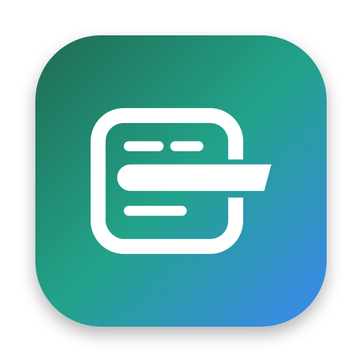
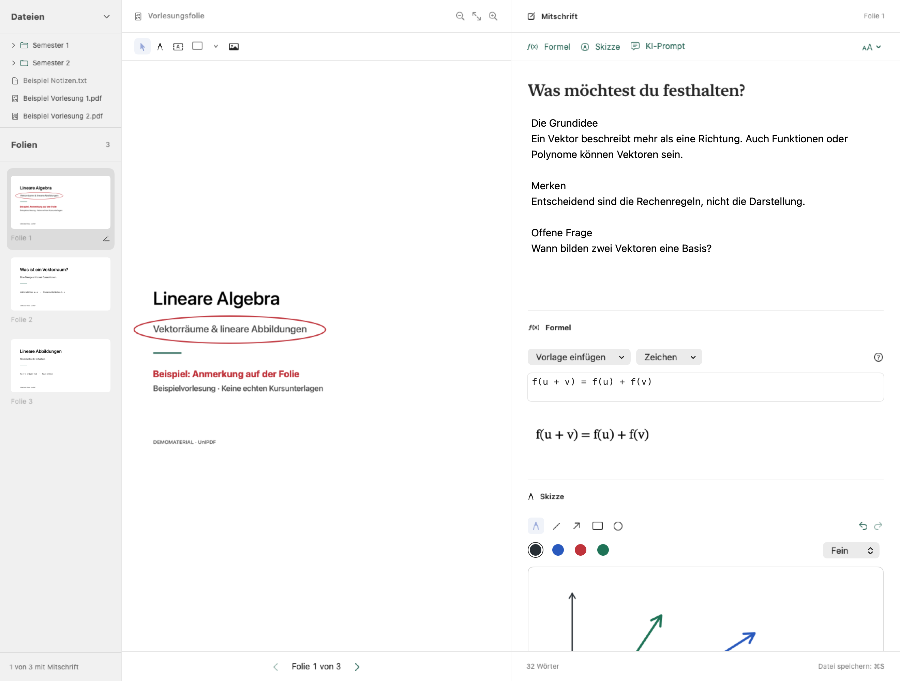
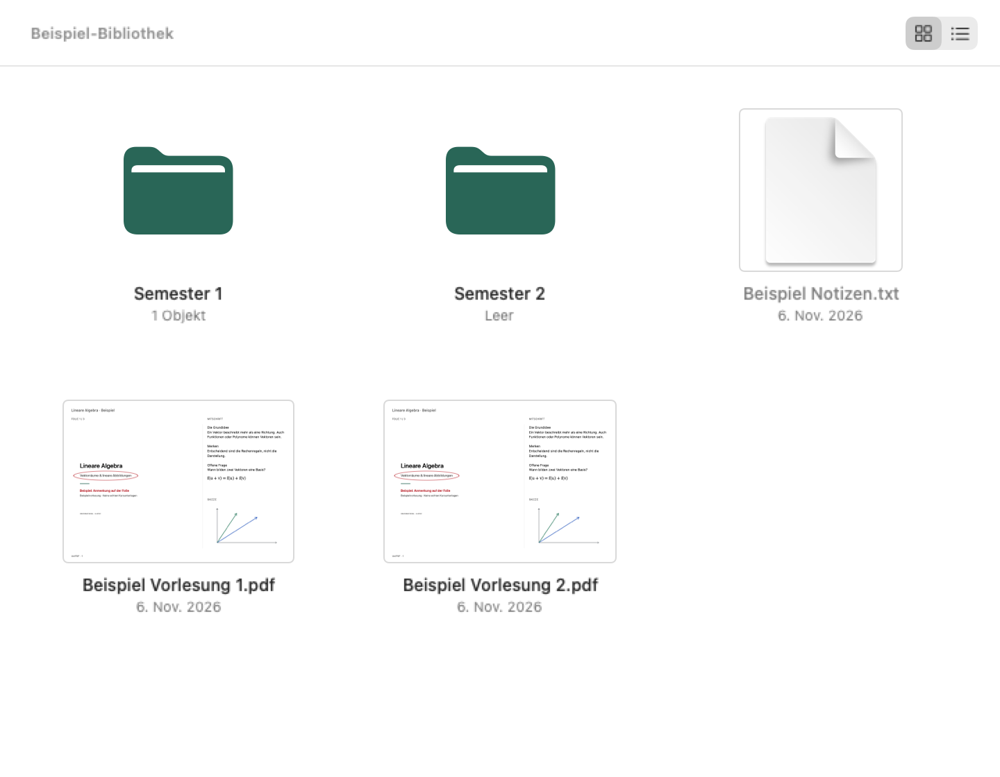
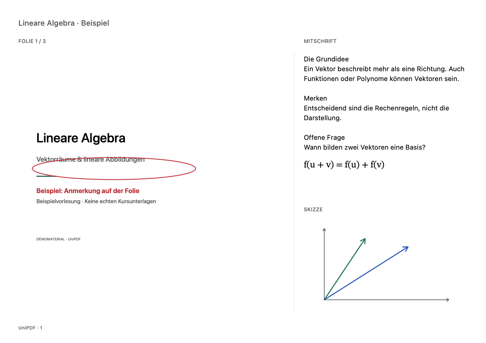

<p align="center">
  
</p>

<h1 align="center">UniPDF</h1>

<p align="center">
  <strong>Deine Vorlesung. Deine Gedanken.</strong><br>
  Vorlesungsfolien lesen, daneben mitschreiben und alles als Lern-PDF speichern.
</p>

<p align="center">
  Native Mac-App &nbsp;·&nbsp; macOS 14+ &nbsp;·&nbsp; Lokal und offline
</p>

<p align="center">
  <a href="#das-kann-unipdf">Funktionen</a> &nbsp;·&nbsp;
  <a href="#schnellstart">Schnellstart</a> &nbsp;·&nbsp;
  <a href="#tastenkürzel">Tastenkürzel</a> &nbsp;·&nbsp;
  <a href="docs/usage.md">Bedienung</a> &nbsp;·&nbsp;
  <a href="#entwicklung">Entwicklung</a>
</p>



## Das kann UniPDF

Links steht die Folie, rechts schreibst du mit. Beim Speichern wird daraus eine PDF, die du später in UniPDF weiterbearbeiten kannst.

| Funktion | Für deinen Lernalltag |
| --- | --- |
| **Mitschriften pro Folie** | Getippte Notizen neben der passenden Folie, formatiert wie im Chat mit `**fett**`, `_kursiv_` und `- Stichpunkten`. Die Trennlinie zwischen Folie und Mitschrift lässt sich verschieben, die Mitschrift ganz einklappen. |
| **Direkt auf der Folie markieren** | PDF-Text mit dem Textmarker hervorheben oder mit Stift, Textfeldern, Formen und Bildern ergänzen. Der Radiergummi entfernt Teile von Strichen und Markierungen. Alles bleibt bearbeitbar. |
| **Formeln und Skizzen** | Formeln mitten im Text zwischen `$ … $`, eine Formelleiste mit Zeichen nach Themengebiet und eine eigene Zeichenfläche mit Stift, Linien, Pfeilen und Formen. |
| **Textstellen kommentieren** | Text markieren, Rechtsklick → **Kommentieren**: Die Stelle wird pastellfarben hinterlegt, in der Mitschrift erscheint ein Tag, der sich zur Kommentar-Karte aufklappen lässt. Auch Bereiche ohne Text lassen sich kommentieren. |
| **Im Dokument suchen** | Durchsucht Folientext, Mitschriften, Textfelder und Kommentare. Die Treffer stehen nach Folien geordnet in der Seitenleiste. |
| **Einzelseite oder fortlaufend** | Folie für Folie arbeiten oder durch alle Folien scrollen, während die Mitschrift mitläuft. |
| **Alles in einer PDF** | Folien, Anmerkungen, Kommentare und Mitschriften gemeinsam speichern oder als zusätzliche Lern-PDF exportieren. |
| **Bibliothek und Tabs** | Vorlesungen in Ordnern verwalten, als Kacheln oder Liste, und mehrere Dateien als Tabs parallel öffnen. |
| **KI-Prompt vorbereiten** | Eine Frage mit dem richtigen Dateipfad und der aktuellen Folie kopieren. Du entscheidest, in welchen KI-Chat sie kommt. |

UniPDF arbeitet komplett lokal mit **SwiftUI, AppKit, PDFKit und CoreText** und hat keine externen Paketabhängigkeiten. Auch der KI-Prompt wird nur in die Zwischenablage kopiert und nie automatisch versendet.

## Ein Blick in die App

| Deine Vorlesungen | Dein Lernskript |
| --- | --- |
| [](docs/images/library.png) | [](docs/images/study-pdf.png) |
| Ordner und Dateien mit Vorschau direkt in UniPDF verwalten. | Folie und Mitschrift gemeinsam zum Lernen mitnehmen. |

Alle Abbildungen zeigen **Demomaterial**, keine echten Kursunterlagen ([Herkunft der Bilder](docs/images/README.md)).

## Schnellstart

**Voraussetzungen:** macOS 14 oder neuer. Zum Bauen außerdem die Apple Command Line Tools mit Swift 6.2 oder neuer; die fertige App braucht kein Swift.

```sh
git clone https://github.com/Snuxx-code/UniPDF.git
cd UniPDF
zsh scripts/build-app.sh
open build/UniPDF.app
```

Alternativ `Package.swift` in Xcode öffnen und das Scheme **UniPDF** starten. Der Build erstellt `build/UniPDF.app` mit einer lokalen Ad-hoc-Signatur. Eine notarisierte Version oder ein App-Store-Paket gibt es derzeit nicht.

### Von der Vorlesung zum Lernskript

1. Mit **⌘O** eine Vorlesungs-PDF öffnen.
2. Eine Folie auswählen und rechts mitschreiben. Bei Bedarf Formeln, Skizzen, Kommentare oder Anmerkungen auf der Folie ergänzen.
3. Mit **⌘S** speichern.
4. Die PDF später wieder in UniPDF öffnen und weiterarbeiten. **Lern-PDF exportieren** (⇧⌘E) erstellt bei Bedarf eine zusätzliche Kopie an einem Ort deiner Wahl.

> [!IMPORTANT]
> **⌘S ersetzt die geöffnete Vorlesungs-PDF am selben Pfad** durch die Version mit deinen Mitschriften. Jeder weitere Speichervorgang aktualisiert diese Datei. Die Originalfolien und alle bearbeitbaren Inhalte stecken in den Metadaten der PDF, deshalb verschachtelt wiederholtes Speichern die Lernseiten nicht. Andere PDF-Programme können diese Metadaten beim Speichern entfernen. Zum Weiterbearbeiten die Datei also in UniPDF sichern.

## Tastenkürzel

| Aktion | Tastenkürzel |
| --- | --- |
| PDF oder Projekt öffnen | **⌘O** |
| Speichern | **⌘S** |
| Lern-PDF exportieren | **⇧⌘E** |
| Vorherige / nächste Folie | **← ↑ / → ↓** oder **⌘↑ / ⌘↓** |
| Im Dokument suchen | **⌘F** |
| Nächster / vorheriger Treffer | **⌘G / ⇧⌘G** |
| Textstelle kommentieren | **⌥⌘M** |
| Fett / kursiv in der Mitschrift | **⌘B / ⌘I** |
| Fortlaufend scrollen ein/aus | **⌥⌘J** |
| Mitschrift ein-/ausklappen | **⌥⌘0** |
| KI-Prompt vorbereiten | **⌥⌘K** |
| Bibliothek öffnen | **⇧⌘L** |
| Anmerkung löschen | **⌫** |
| Werkzeug beenden / Auswahl aufheben | **Esc** |
| Rückgängig | **⌘Z** |

Die Pfeiltasten wechseln nur dann die Folie, wenn du gerade nicht schreibst. In Mitschrift, Formeln und Textfeldern bewegen sie den Cursor, bei einer ausgewählten Anmerkung verschieben sie diese, in der Bibliothek wählen sie Dateien aus.

## Mehr zur Bedienung

Die [ausführliche Anleitung](docs/usage.md) erklärt alles im Detail:

- [Speichern und Wiederöffnen](docs/usage.md#benutzen), Einzelseite und fortlaufendes Scrollen
- [Auf der Folie markieren](docs/usage.md#auf-der-folie-markieren): Stift, Textmarker, Radiergummi, Textfelder, Formen, Bilder
- [Textstellen kommentieren](docs/usage.md#textstellen-kommentieren) und [im Dokument suchen](docs/usage.md#im-dokument-suchen)
- [Formatierung der Mitschrift](docs/usage.md#formatierung-der-mitschrift) und [Formeln](docs/usage.md#formeln) mit der unterstützten Notation
- [Bibliothek](docs/usage.md#bibliothek), [mehrere Dateien](docs/usage.md#mehrere-dateien) und [KI-Prompts](docs/usage.md#eine-frage-an-die-ki-vorbereiten)

Ältere `.unipdf`-Projekte werden weiterhin unterstützt.

## Entwicklung

```sh
# App bauen
zsh scripts/build-app.sh

# Tests ausführen
zsh scripts/test.sh
```

Die Tests prüfen unter anderem das Speichern am Originalpfad, das Wiederöffnen bearbeitbarer PDFs, lange Mitschriften, die Suche und die Position von Anmerkungen auf gedrehten und beschnittenen Folien.

| Pfad | Inhalt |
| --- | --- |
| [`Sources/UniPDF`](Sources/UniPDF) | Native Oberfläche, Dokumente und Bibliothek |
| [`Sources/UniPDFCore`](Sources/UniPDFCore) | Projektmodell, PDF-Export und Rendering |
| [`Tests`](Tests) | Tests für Dokumente, Export, Anmerkungen und Dateiverwaltung |
| [`scripts`](scripts) | Build, App-Icon und Testlauf |
| [`docs`](docs) | Anleitung und Bilder für dieses README |
