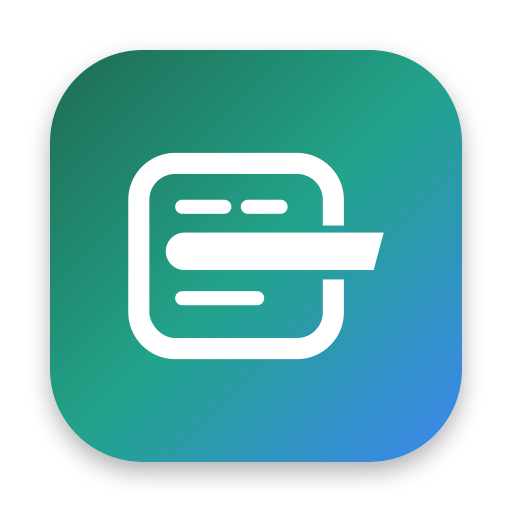
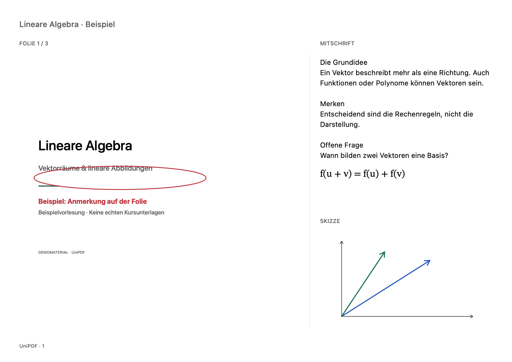

<p align="center">
  
</p>

<h1 align="center">UniPDF</h1>

<p align="center">
  <strong>Your lecture. Your thoughts.</strong><br>
  Read lecture slides, take notes right beside them and save everything as a study PDF.
</p>

<p align="center">
  Native Mac app &nbsp;·&nbsp; macOS 14+ &nbsp;·&nbsp; Local and offline &nbsp;·&nbsp; English and German
</p>

<p align="center"><strong>English</strong> · <a href="README.de.md">Deutsch</a></p>

<p align="center">
  <a href="#what-unipdf-does">Features</a> &nbsp;·&nbsp;
  <a href="#quick-start">Quick start</a> &nbsp;·&nbsp;
  <a href="#keyboard-shortcuts">Shortcuts</a> &nbsp;·&nbsp;
  <a href="docs/usage.md">Guide</a> &nbsp;·&nbsp;
  <a href="#development">Development</a>
</p>

<picture>
  <source media="(prefers-color-scheme: dark)" srcset="docs/images/workspace-dark.png">
  
</picture>

## What UniPDF does

The slide is on the left, and you write on the right. When you save, it becomes a PDF that you can keep editing in UniPDF later.

| Feature | For your studies |
| --- | --- |
| **Notes for every slide** | Typed notes next to the matching slide, formatted like a chat with `**bold**`, `_italic_` and `- bullets`, with nested bullets via Tab and spelling correction that recognizes English and German. Drag the divider between slide and notes, or collapse the notes entirely. |
| **Mark up the slide itself** | Highlight PDF text with the highlighter, or add pen strokes, text boxes, shapes and images. The eraser removes parts of strokes and highlights. Everything stays editable. |
| **Formulas and sketches** | Formulas right in the text between `$ … $`, a formula bar with symbols by topic, and a sketch area with pen, lines, arrows and shapes. |
| **Comment on passages** | Select text, right-click → **Comment**: the passage gets a pastel background, and a tag appears in your notes that expands into a comment card. Areas without text can be commented on too. |
| **Search the document** | Searches slide text, notes, text boxes and comments. Results are listed by slide in the sidebar. |
| **Single page or continuous** | Work slide by slide, or scroll through all slides while the notes follow along. |
| **Everything in one PDF** | Save slides, annotations, comments and notes together, or export them as an additional study PDF. |
| **Library and tabs** | Organize lectures in folders, as tiles or a list, and open several files side by side as tabs. |
| **Prepare an AI prompt** | Copy a question with the right file path and the current slide. You decide which AI chat it goes into. |
| **Work with Claude, live** | Connect Claude Desktop or Claude Code, and Claude reads your slides and notes, comments on passages, highlights and adds to your notes – right in the open lecture, each step undoable with ⌘Z. |

UniPDF works entirely locally with **SwiftUI, AppKit, PDFKit and CoreText** and has no external package dependencies. The AI prompt, too, is only copied to the clipboard and never sent anywhere automatically.

## A look at the app

| Your lectures | Your study notes |
| --- | --- |
| [](docs/images/library.png) | [](docs/images/study-pdf.png) |
| Manage folders and files with thumbnails right in UniPDF. | Take slide and notes with you to study. |

All images show **demo material**, not real course material ([where the images come from](docs/images/README.md)).

## Quick start

**Requirements:** macOS 14 or later. To build, you also need the Apple Command Line Tools with Swift 6.2 or later; the built app does not need Swift.

```sh
git clone https://github.com/Snuxx-code/UniPDF.git
cd UniPDF
zsh scripts/build-app.sh
open build/UniPDF.app
```

Alternatively, open `Package.swift` in Xcode and run the **UniPDF** scheme; the app then runs in English only, because the translations are added by `build-app.sh`. The build creates `build/UniPDF.app` with a local ad-hoc signature. There is currently no notarized release or App Store package.

### From lecture to study notes

1. Open a lecture PDF with **⌘O**.
2. Choose a slide and write your notes on the right. Add formulas, sketches, comments or annotations on the slide as you need them.
3. Save with **⌘S**.
4. Open the PDF in UniPDF again later and keep working. **Export Study PDF** (⇧⌘E) creates an additional copy wherever you like.

> [!IMPORTANT]
> **⌘S replaces the open lecture PDF at the same path** with the version that contains your notes. Every later save updates this file. The original slides and all editable content are stored in the PDF's metadata, so saving again does not nest the study pages. Other PDF apps can remove this metadata when they save, so save the file in UniPDF to keep editing it.

## Claude in UniPDF

UniPDF can be connected to Claude through the Model Context Protocol (MCP). Claude then works on the lecture that is open in UniPDF while you watch: it reads slides and notes, comments on passages, highlights them, adds to the notes and goes to a slide. Every change arrives at once, can be taken back with **⌘Z** and is saved like your own.

**Claude Desktop:** add UniPDF to `~/Library/Application Support/Claude/claude_desktop_config.json` and restart Claude:

```json
{
  "mcpServers": {
    "unipdf": { "command": "/Applications/UniPDF.app/Contents/MacOS/UniPDF", "args": ["--mcp"] }
  }
}
```

**Claude Code:**

```sh
claude mcp add --scope user unipdf -- /Applications/UniPDF.app/Contents/MacOS/UniPDF --mcp
```

Keep UniPDF open with the lecture. `UniPDF --mcp` opens no window: it only passes Claude's requests to the running app through a socket in `~/Library/Application Support/UniPDF` that only your user can open. Nothing leaves your Mac except what you share with Claude in the chat. The tools are `open_documents`, `read_slide`, `current_selection`, `add_comment`, `edit_comment`, `delete_comment`, `add_notes`, `highlight_text` and `go_to_slide`; Claude adds to your notes but never rewrites or deletes them; besides its own, it can change or remove existing comments.

## Keyboard shortcuts

| Action | Shortcut |
| --- | --- |
| Open PDF or project | **⌘O** |
| Save | **⌘S** |
| Export study PDF | **⇧⌘E** |
| Previous / next slide | **← ↑ / → ↓** or **⌘↑ / ⌘↓** |
| Search the document | **⌘F** |
| Next / previous result | **⌘G / ⇧⌘G** |
| Comment on a passage | **⌥⌘M** |
| Bold / italic in the notes | **⌘B / ⌘I** |
| Scroll continuously on/off | **⌥⌘J** |
| Show/hide notes | **⌥⌘0** |
| Prepare AI prompt | **⌥⌘K** |
| Open library | **⇧⌘L** |
| Delete annotation | **⌫** |
| End tool / clear selection | **Esc** |
| Undo | **⌘Z** |

The arrow keys only change slides while you are not typing. In notes, formulas and text boxes they move the cursor, with an annotation selected they move it, and in the library they select files.

## More about using UniPDF

The [full guide](docs/usage.md) explains everything in detail:

- [Saving and reopening](docs/usage.md#getting-started), single page and continuous scrolling
- [Marking up the slide](docs/usage.md#marking-up-the-slide): pen, highlighter, eraser, text boxes, shapes, images
- [Commenting on passages](docs/usage.md#commenting-on-passages) and [searching the document](docs/usage.md#searching-the-document)
- [Formatting notes](docs/usage.md#formatting-notes) and [formulas](docs/usage.md#formulas) with the supported notation
- [Library](docs/usage.md#library), [several files](docs/usage.md#several-files) and [AI prompts](docs/usage.md#preparing-a-question-for-an-ai)

Older `.unipdf` projects are still supported. UniPDF follows your Mac's language, English or German ([more](docs/usage.md#language)).

## Development

```sh
# Build the app
zsh scripts/build-app.sh

# Run the tests
zsh scripts/test.sh

# Check that every interface text is translated
zsh scripts/check-localization.sh
```

The tests cover, among other things, saving at the original path, reopening editable PDFs, long notes, search, and the position of annotations on rotated and cropped slides.

The texts in the code are English. The German translation lives in [`Resources/de.lproj/Localizable.strings`](Resources/de.lproj/Localizable.strings); `check-localization.sh` reports texts without a translation, translations nothing uses any more, and placeholders that differ.

| Path | Contents |
| --- | --- |
| [`Sources/UniPDF`](Sources/UniPDF) | Native interface, documents and library |
| [`Sources/UniPDFCore`](Sources/UniPDFCore) | Project model, PDF export and rendering |
| [`Tests`](Tests) | Tests for documents, export, annotations and file management |
| [`Resources`](Resources) | Info.plist and translations |
| [`scripts`](scripts) | Build, app icon, test run and translation check |
| [`docs`](docs) | Guide and images for this README |

## License

UniPDF is open source under the [MIT License](LICENSE).
