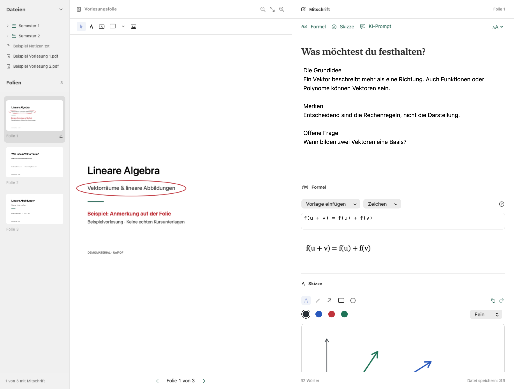
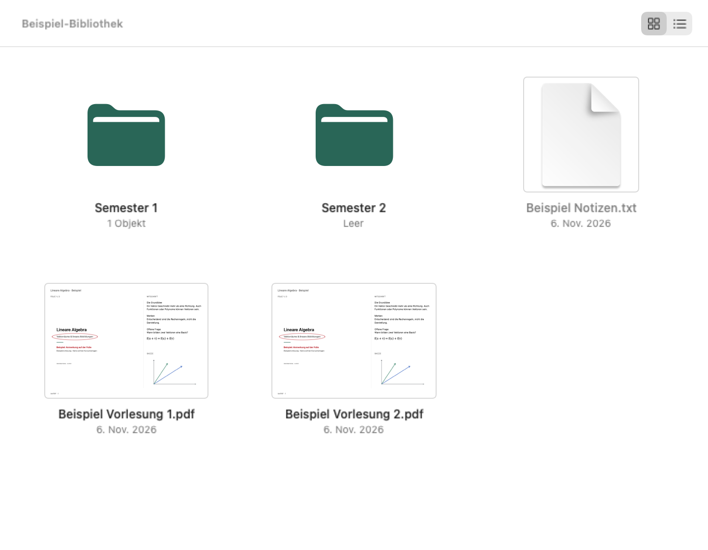

<p align="center">
  
</p>

<h1 align="center">UniPDF</h1>

<p align="center">
  <strong>Deine Vorlesung. Deine Gedanken.</strong><br>
  Vorlesungsfolien lesen, daneben mitschreiben und alles als Lern-PDF speichern.
</p>

<p align="center">
  Native Mac-App &nbsp;·&nbsp; macOS 14+ &nbsp;·&nbsp; Lokal und offline
</p>

<p align="center">
  <a href="#das-kann-unipdf">Funktionen</a> &nbsp;·&nbsp;
  <a href="#schnellstart">Schnellstart</a> &nbsp;·&nbsp;
  <a href="docs/usage.md">Bedienung</a> &nbsp;·&nbsp;
  <a href="#entwicklung">Entwicklung</a>
</p>



Im PDF-Bereich wechseln **→ / ↓** zur nächsten und **← / ↑** zur vorherigen Folie. An der ersten und letzten Folie bleibt die Auswahl stehen. **⌘↑ / ⌘↓** funktionieren weiterhin als direkte Befehle. Beim Schreiben in Mitschriften, Formeln und Textfeldern bleiben die Pfeiltasten für den Textcursor zuständig. Ist eine Anmerkung ausgewählt, verschieben sie weiterhin diese Anmerkung; mit **Esc** abwählen, um wieder zwischen Folien zu wechseln. Die Pfeile in der Dateiliste navigieren weiter durch die Liste.

Die Breite von PDF und Mitschrift lässt sich an der Trennlinie anpassen. UniPDF merkt sich die Breite der Mitschrift und die Fenstergröße auch über Neustarts hinweg; die Bibliothek hat ihre eigene Fenstergröße. Die Zeichenfläche unterstützt Stift, Linie, Pfeil, Rechteck und Ellipse, vier Farben und drei Strichstärken. Elemente lassen sich schrittweise entfernen und wiederherstellen.

## Das kann UniPDF

Eine Folie und deine Gedanken stehen direkt nebeneinander. Aus deiner Mitschrift entsteht eine PDF, die du später in UniPDF weiterbearbeiten kannst.

| Funktion | Für deinen Lernalltag |
| --- | --- |
| **Mitschriften pro Folie** | Getippte Notizen neben der passenden Folie; die Breite beider Bereiche ist anpassbar. |
| **Direkt auf der Folie markieren** | PDF-Text mit dem Textmarker hervorheben oder mit Stift, Textfeldern, Formen und Bildern ergänzen. Markierungen bleiben bearbeitbar. |
| **Formeln und Skizzen** | Formeln mit Live-Vorschau und eine eigene Zeichenfläche mit Stift, Linien, Pfeilen und Formen. |
| **Alles in einer PDF** | Folien, Anmerkungen und Mitschriften gemeinsam speichern oder als zusätzliche Lern-PDF exportieren. |
| **Bibliothek und Tabs** | Vorlesungen in Ordnern, als Kacheln oder Liste verwalten und mehrere Dateien parallel öffnen. |
| **KI-Prompt vorbereiten** | Eine Frage mit dem richtigen Dateipfad und der aktuellen Folie kopieren. Du entscheidest, in welchen KI-Chat sie kommt. |

Die App arbeitet lokal mit **SwiftUI, AppKit, PDFKit und CoreText**, ohne externe Paketabhängigkeiten. Der KI-Prompt wird lokal erstellt; UniPDF sendet ihn nicht automatisch an einen Dienst.

## Ein Blick in die App

| Deine Vorlesungen | Dein Lernskript |
| --- | --- |
| [](docs/images/library.png) | [](docs/images/study-pdf.png) |
| Ordner und Dateien mit Vorschau direkt in UniPDF verwalten. | Folie und Mitschrift gemeinsam zum Lernen mitnehmen. |

Alle Abbildungen verwenden **Demomaterial**, keine echten Kursunterlagen. [Herkunft und Erstellung der Bilder](docs/images/README.md).

## Schnellstart

**Voraussetzungen:** macOS 14 oder neuer und Apple Command Line Tools mit Swift 6.2 oder neuer. Zum Verwenden der gebauten App ist Swift nicht erforderlich.

```sh
git clone https://github.com/Snuxx-code/UniPDF.git
cd UniPDF
zsh scripts/build-app.sh
open build/UniPDF.app
```

Alternativ `Package.swift` in Xcode öffnen und das Scheme **UniPDF** starten. Der Build erstellt `build/UniPDF.app` mit einer lokalen Ad-hoc-Signatur. Eine notarisierte Veröffentlichung oder ein App-Store-Paket gehört derzeit nicht zum Projekt.

### Von der Vorlesung zum Lernskript

1. Mit **⌘O** eine Vorlesungs-PDF öffnen.
2. Eine Folie auswählen und rechts mitschreiben. Bei Bedarf Formeln, Skizzen oder Anmerkungen auf der Folie ergänzen.
3. Mit **⌘S** speichern. **Die ursprünglich geöffnete PDF wird am selben Pfad durch die Version mit Mitschriften ersetzt.** Jeder weitere Speichervorgang aktualisiert diese Datei.
4. Die PDF später wieder in UniPDF öffnen und weiterarbeiten. **Lern-PDF exportieren** erstellt bei Bedarf eine zusätzliche Kopie.

Die PDF enthält neben den sichtbaren Seiten auch die Originalfolien und bearbeitbaren Inhalte in ihren Metadaten. Wiederholtes Speichern verschachtelt die Lernseiten nicht. Andere PDF-Programme können diese Metadaten beim Speichern entfernen; zum Weiterbearbeiten in UniPDF sichern.

### Die wichtigsten Tastenkürzel

| Aktion | Tastenkürzel |
| --- | --- |
| PDF oder Projekt öffnen | **⌘O** |
| Speichern | **⌘S** |
| Vorherige / nächste Folie | **⌘↑ / ⌘↓** |
| Lern-PDF exportieren | **⇧⌘E** |
| Bibliothek öffnen | **⇧⌘L** |
| KI-Prompt vorbereiten | **⌥⌘K** |
| Anmerkung löschen | **⌫** |
| Werkzeug beenden / Auswahl aufheben | **Esc** |
| Rückgängig | **⌘Z** |

In der Bibliothek und bei ausgewählten Anmerkungen haben Pfeiltasten ihre jeweilige Navigations- bzw. Verschiebefunktion.

## Mehr zur Bedienung

Die [ausführliche Anleitung](docs/usage.md) erklärt das Speichern und Wiederöffnen, Anmerkungen, Bibliothek, Tabs, KI-Prompts und die unterstützte Formelnotation. Bestehende `.unipdf`-Projekte werden weiterhin unterstützt.

## Entwicklung

```sh
# App bauen
zsh scripts/build-app.sh

# Automatisierte Tests ausführen
zsh scripts/test.sh
```

Die Tests prüfen unter anderem das Speichern am Originalpfad, das Wiederöffnen bearbeitbarer PDFs, lange Mitschriften sowie die Position von Anmerkungen auf gedrehten und beschnittenen Folien.

| Pfad | Inhalt |
| --- | --- |
| [`Sources/UniPDF`](Sources/UniPDF) | Native Oberfläche, Dokumente und Bibliothek |
| [`Sources/UniPDFCore`](Sources/UniPDFCore) | Projektmodell, PDF-Export und Rendering |
| [`Tests`](Tests) | Tests für Dokumente, Export, Anmerkungen und Dateiverwaltung |
| [`scripts`](scripts) | Build, App-Icon und Testlauf |
